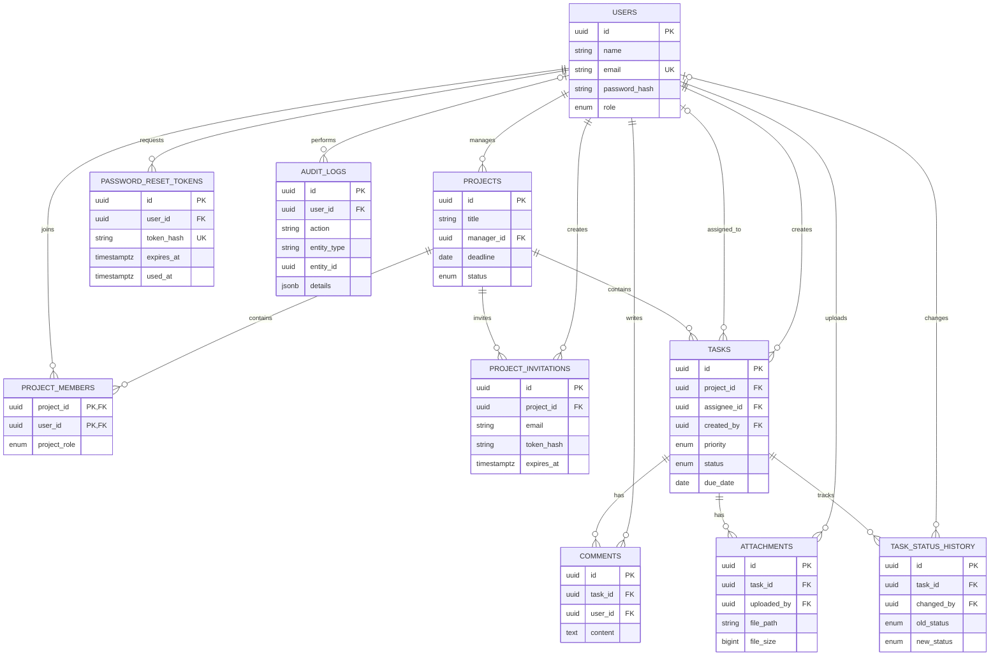

# Database entity relationship diagram

All foreign keys cascade or set null according to the data's ownership. See `server/models/schema.sql` and ordered SQL migrations for the complete PostgreSQL definition.
